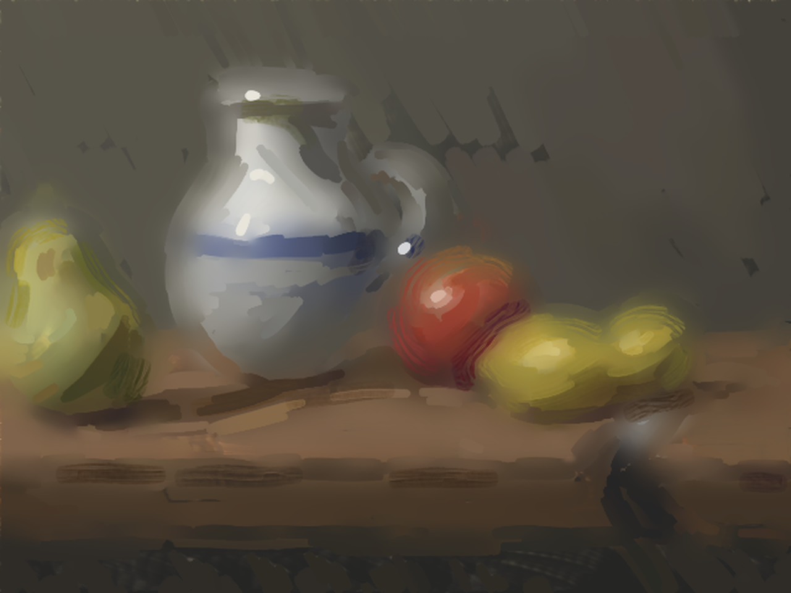
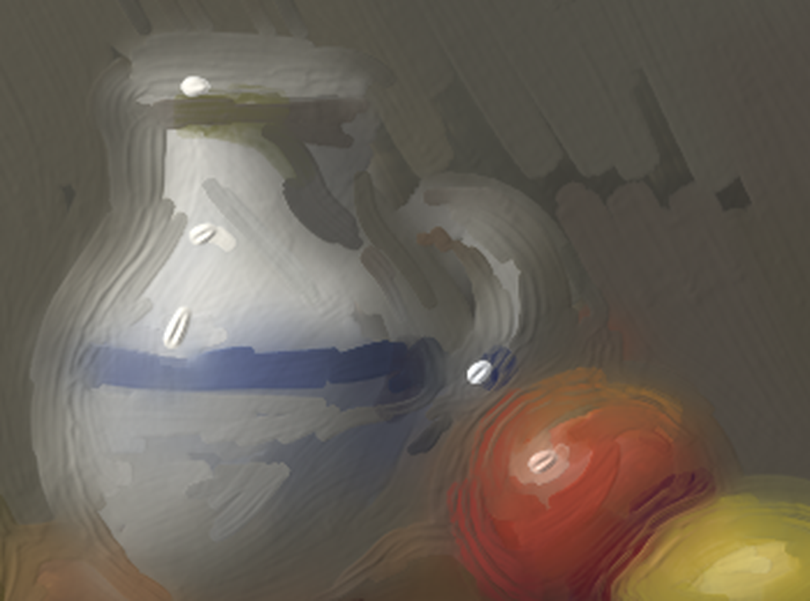

# goo

A physical paint medium, the tools that move it, and the sensors that scan the result.

Watercolour and oil are one material here: a depth-averaged layer of pigment suspended in water or oil, on a
gesso ground, over the strata it has dried into. Leveling is Bingham thin-film flow with a Krieger–Dougherty
viscosity and a yield stress that grows as the paint jams, so a dilute wash levels its brush marks, a short
paste holds them, and curing oil freezes. Brushes drag, plough and exchange paint with a load. Colour is
Kubelka–Munk, layer by layer, in R, G, B and 1.5 µm, so an underdrawing hidden in the visible shows in the
infrared. A simulated FMCW lidar scans the surface, speckle and all.

Nothing is drawn: every edge, groove, burr and bloom comes out of the laws (see `SPEC.md`).



*Still life with jug, fruit and knife*: 16 × 12 cm, oil over a charcoal drawing and a sienna imprimatura on gesso;
three sittings, glazes, impasto, a scratched signature. About 31,000 brush ticks, painted in 20 minutes on two CPU
cores by `goo.painter` from a motif it set up and lit itself. Mean colour error against the motif: ΔE 4.2.
Every unit of paint accounted for (relative residual 2e-14).



Under raking light: strokes that wrap the forms, impasto highlights with bristle grooves, hatching on the wall.

```
pip install -e ".[dev]"
python -m pytest -q
python paintings/stilllife/reference.py   # render the motif (~4 min)
python paintings/stilllife/paint.py       # paint it (~20 min on 2 cores); SCALE=0.5 for a 4-minute test
CANVAS=out/stilllife/canvas.pkl OUT=out/stilllife NAME=stilllife python studies/scan.py
```

## How the painter works

`goo.painter.Painter` sees only colour. For each pass it compares the canvas to the motif simplified at the
brush's own scale (each object blurred within itself), puts strokes where the difference is largest, curves them
along the motif's structure where there is any and along a plan where there isn't (diagonal hatching on a wall,
around the form on a fruit), stops them at an object's edge, and mixes each colour by inverting Kubelka–Munk over
what the canvas shows along the stroke, averaged over the thicknesses its brush actually lays (it tests each brush
on a scrap of panel first). Sittings dry between them; glazes go last, over dry paint, in transparent colours.

| | |
|---|---|
| `goo/engine.py` | the World: `Canvas`, its laws and ledger, its optics |
| `goo/brush.py` | `Brush`, `Stylus` |
| `goo/sensors/` | `lidar` (averaged spot, direct detection), `coherent` (FMCW, speckle) |
| `goo/palette.py`, `goo/painter.py` | mixing by inverting the optics; a painter that looks |
| `paintings/` | paintings: a pear (scripted strokes), a still life (the painter) |
| `studies/` | measurements: scans, sensor studies, figures |

MIT licensed.
