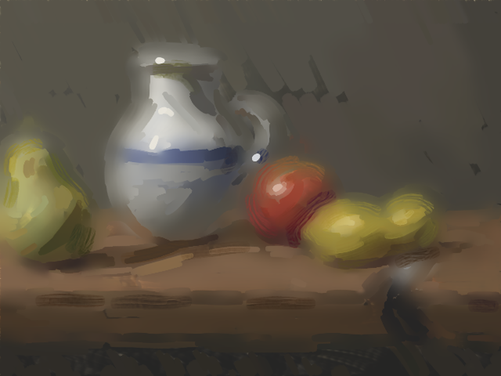
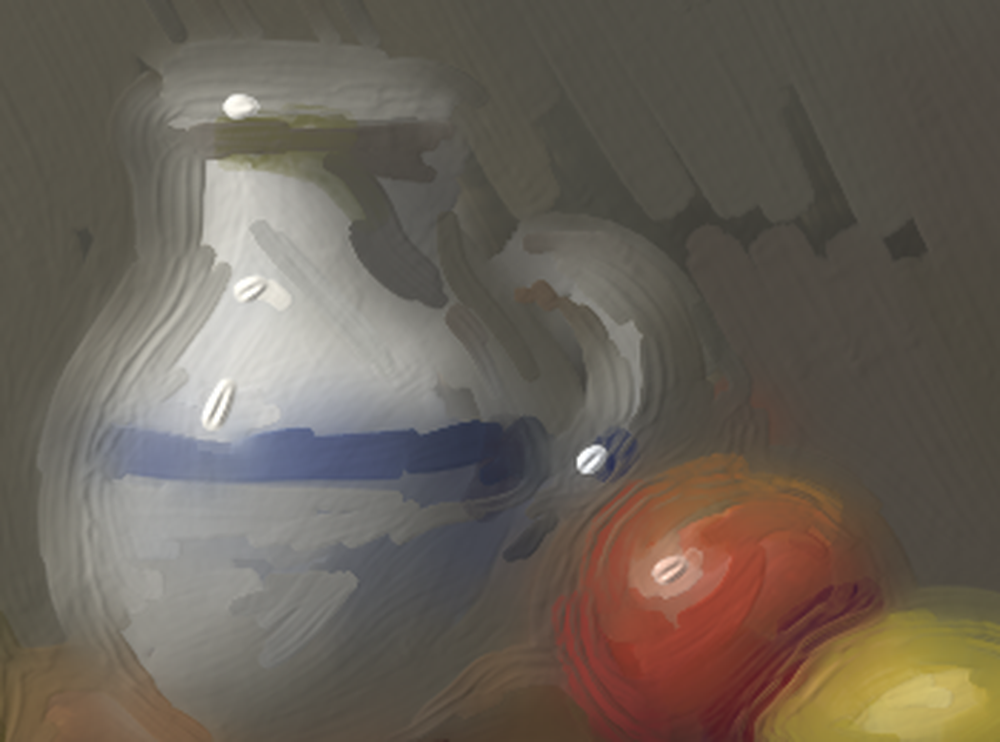

> **Deprecated.** This is goo classic, the first engine, frozen at commit 6fcca08 (branch `goo-classic`). It is not developed further. The kernel that replaces it is specified in the repository's root `SPEC.md`.

# goo

A physical paint medium, the tools that move it, and the sensors that scan the result.

Watercolour, gouache, acrylic and oil are one material here: a depth-averaged layer of pigment suspended in water
or oil, on a paper or gesso ground, over the strata it has dried into. Leveling is Bingham thin-film flow with a
Krieger–Dougherty viscosity and a yield stress that grows as the paint jams, so a dilute wash levels its brush
marks, a short paste holds them, and curing oil freezes. Brushes, a knife, a blotter and spatter drag, plough and
exchange paint with a load, and every unit is booked. Colour is Kubelka–Munk, layer by layer, in R, G, B and
1.5 µm, so an underdrawing hidden in the visible shows in the infrared; an opt-in spectral model (optics v2) adds
what surrounds each particle, a surface and a porous ground. A simulated FMCW lidar scans the surface, speckle
and all.

Nothing is drawn: every edge, groove, burr and bloom comes out of the laws (see `classic/SPEC.md`, the contract; §15
there says what is verified and what is not). `docs/VISION.md` is where goo is meant to go, and how far it is.



*Still life with jug, fruit and knife*: 16 × 12 cm, oil over a charcoal drawing and a sienna imprimatura on gesso;
three sittings, glazes, impasto, a scratched signature. About 31,000 brush ticks, painted in 20 minutes on two CPU
cores by `goo.classic.painter` from a motif it set up and lit itself. Mean colour error against the motif: ΔE 4.2.
Every unit of paint accounted for (relative residual 2e-14).



Under raking light: strokes that wrap the forms, impasto highlights with bristle grooves, hatching on the wall.

## Running

```
pip install -e ".[dev]"
PYTHONPATH=$PWD python -m pytest classic/tests -q   # ~2 min; 215 pass, 1 skipped (needs REFRACTIVEINDEX_DB, below)
python classic/paintings/stilllife/reference.py    # render the motif (~4 min)
python classic/paintings/stilllife/paint.py        # paint it (~20 min on 2 cores); SCALE=0.5 for a 4-minute test
CANVAS=out/stilllife/canvas.pkl OUT=out/stilllife NAME=stilllife python classic/studies/scan.py
CANVAS=out/stilllife/canvas.pkl OUT=out NAME=stilllife python classic/studies/relight.py   # the panel under three lights
python classic/paintings/sampler/paint.py          # a pixel-art motif, painted (~1.5 min)
python classic/paintings/estuary/paint.py          # a watercolour painted in the studio's vocabulary
```

Run scripts with the repository root on `PYTHONPATH` if another copy of goo is installed. Outputs go to `out/`.

## The easel

`goo.classic.easel` is the studio one command at a time, with its state on disk, for painting look-act-look from a shell:

```
python -m goo.classic.easel out/s1 new --size 400x300 --pigments ultramarine,rose,ochre,sienna --medium watercolour
python -m goo.classic.easel out/s1 do '{"do": "wet", "region": {"band": [0, 172]}}'
python -m goo.classic.easel out/s1 do '{"do": "graded_wash", "region": {"band": [0, 172]}, "from": "ultramarine", "to": "ochre"}'
python -m goo.classic.easel out/s1 rehearse '[{"do": "dry", "until": "damp"}, {"do": "dry", "until": "touch"}]'   # nothing changes
python -m goo.classic.easel out/s1 look --wet       # glistening, damp and not-yet-dry cells marked
python -m goo.classic.easel out/s1 back 1           # undo the last act
python -m goo.classic.easel out/s1 help             # every act, with an example
```

Each command writes `out/s1/look.png` and prints a JSON receipt. The same acts are methods of `goo.classic.studio.Studio`
(`wash`, `graded_wash`, `drop_in`, `backrun`, `glaze`, `dry_brush`, `lift`, `reserve`, `dry`, ...), which can also
`rehearse()` on a fork of the canvas and `keep()` the result. The studio sees the canvas only as a painter would:
colour, sheen and the finger test.

## How the painter works

`goo.classic.painter.Painter` sees only colour. For each pass it compares the canvas to the motif simplified at the
brush's own scale (each object blurred within itself), puts strokes where the difference is largest, curves them
along the motif's structure where there is any and along a plan where there isn't (diagonal hatching on a wall,
around the form on a fruit), stops them at an object's edge, and mixes each colour by inverting Kubelka–Munk over
what the canvas shows along the stroke, averaged over the thicknesses its brush actually lays (it tests each brush
on a scrap of panel first). Sittings dry between them; glazes go last, over dry paint, in transparent colours.

`goo.classic.detail.DetailPainter` is the same painter for motifs with features a cell or two wide, such as pixel art or a
texture page. It splits the motif into broad masses and fine features, paints and checks the masses region by
region, then traces the features with brushes as wide as they are, one colour at a time, drying between. It still
sees only colour, and a test holds it to that with a canvas behind glass (`classic/SPEC.md` §10).

## A painting as a surface

`Surface.from_canvas(cv)` is what the World shows a sensor: height, reflectance in the optics model's bands,
roughness and gloss. A cured oil film is glossy, as a wet one is; dried watercolour and gesso are matte.
`goo.classic.sensors.relight` renders a surface under a distant light with cast shadows, a sky and an energy-conserving
gloss lobe, and `texels()` averages cells into the texels of a texture.

## Studies of optics and matter

```
PYTHONPATH=$PWD python classic/studies/optics.py        # classic beside v2: washes drying, acrylic, black, CPVC, the pear
                                                # under two lights (run classic/paintings/pear.py first); out/optics-study.png
REFRACTIVEINDEX_DB=/path/to/clone python classic/studies/optics_data.py            # regenerate goo/classic/data/optics.json: diff
REFRACTIVEINDEX_DB=/path/to/clone python classic/studies/optics_data.py --report   # the tables in classic/docs/OPTICS-DATA.md
PYTHONPATH=$PWD python classic/studies/matter.py        # Mie checks, classic pigments as substances, inverse-design
                                                # searches, an impossible substance; out/matter.png
```

`classic/studies/optics_data.py` needs a clone of the refractiveindex.info database and `pip install miepython pyyaml`
(`colour-science` too for `--report`); none of these is a run-time dependency of goo. `classic/docs/OPTICS-DATA.md`
and `classic/docs/MATTER.md` give the methods and the findings; the main one is that goo's classic K and S are about
155 times weaker than physical values where measured constants exist (`classic/SPEC.md` §13).

## Modules

| | |
|---|---|
| `goo/classic/engine.py` | the World: `Canvas`, its laws and ledger; `fork`, `sheen`, `touch_dry`, `mask` / `unmask`, `fix(region=...)` |
| `goo/classic/optics.py` | optics models: `classic` (default) and `v2` (opt-in); lights, observer, species and ground tables |
| `goo/classic/brush.py` | `Brush` (round and flat), `Stylus`, `Receipt` |
| `goo/classic/tools.py` | `Knife`, `Blotter`, `spatter`; the interface every tool shares |
| `goo/classic/paints.py` | `Paint` recipes per medium, `preview`, `mix_for`, `swatch_card` |
| `goo/classic/palette.py`, `goo/classic/painter.py`, `goo/classic/detail.py` | mixing by inverting the optics; a painter that looks; a painter for fine features |
| `goo/classic/studio.py`, `goo/classic/easel.py` | a studio of techniques with a journal and rehearsals; its command line |
| `goo/classic/surface.py` | `Surface`: what a sensor is handed |
| `goo/classic/sensors/` | `lidar` (averaged spot, direct detection), `coherent` (FMCW, speckle), `relight` (visible light) |
| `goo/classic/data/` | `optics.json`, optical constants and K, S spectra with provenance, and its loader (not yet used by the engine) |
| `goo/classic/matter/` | substances as descriptions: dielectric functions, morphology, Mie, admissibility laws, data sheets (not yet used by the engine) |
| `classic/paintings/` | a pear (scripted strokes), a still life (the painter), a sampler (the detail painter), an estuary (the studio) |
| `classic/studies/` | measurements: scans, relighting, sensor studies, optics, optical data, matter, figures |
| `classic/docs/` | figures; `MATTER.md`, `OPTICS-DATA.md` (`VISION.md` and `MATTER-SPEC.md` stay in `docs/`) |

The engine works only where there is something to do: on a 1024 × 1024 panel a brush touch costs about a
millisecond and dried layers are stored cropped, with results bit-identical to computing the whole panel.

## Data and licence

goo is MIT licensed. The optical numbers shipped in `goo/classic/data/optics.json` are computed by goo's own generator
from the CC0 1.0 refractiveindex.info database (Polyanskiy, *Sci. Data* 11, 94, 2024), each constant's original
measurement paper cited in the file; where no such constant exists the number is goo's own guess and marked so.
References with restricted or unclear licences (RIT, Golden, IFAC-CNR, LBNL, Handprint) were read for sanity
checks only; nothing from them is included.
